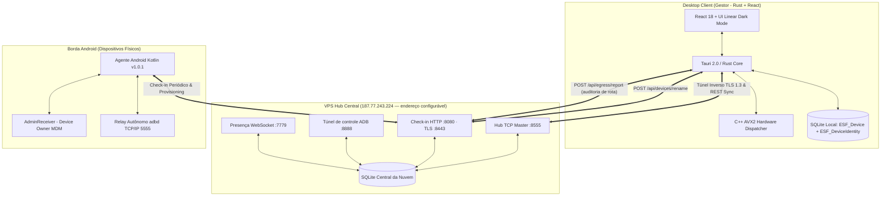
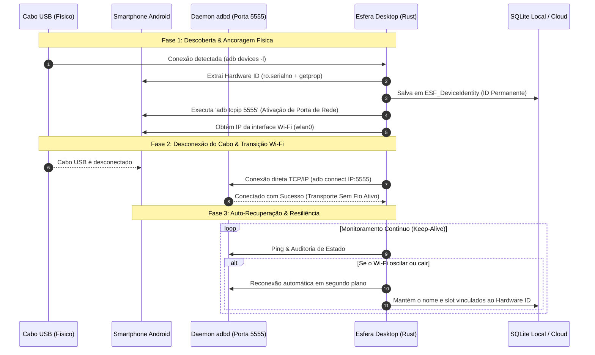
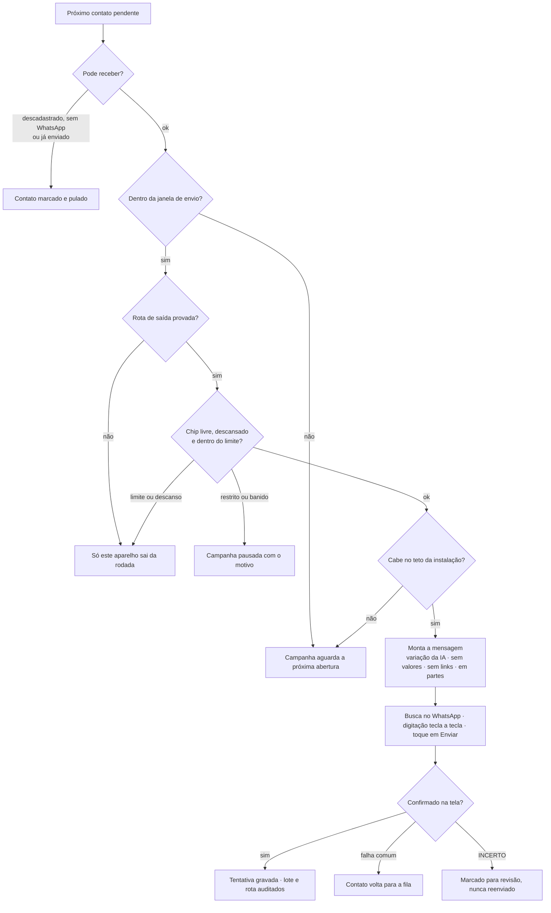
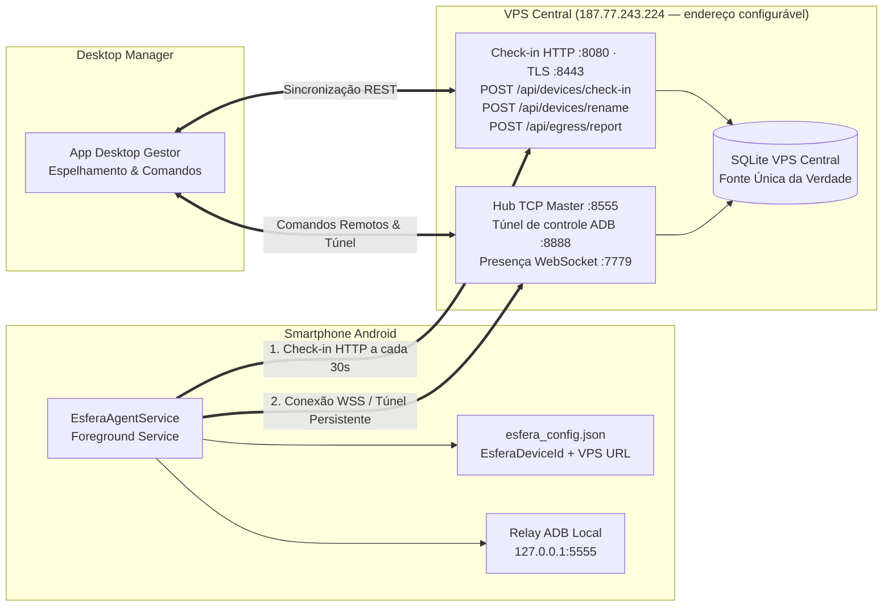

# ⚡ ESFERA v3 — Enterprise Android Fleet & Automation Platform

> **Plataforma High-Performance Computing (HPC) para Orquestração, Gestão MDM Enterprise e Controle Remoto Inteligente de Dispositivos Android.**

---


---

## 🚀 Visão Geral

O **Esfera v3** é uma solução corporativa de alta performance desenvolvida para orquestração de frotas Android, espelhamento ultrarrápido, execução distribuída de comandos e gerenciamento remoto avançado em escala industrial.

O ecossistema opera sob uma **arquitetura híbrida dual**: combina o rigor das políticas **MDM Enterprise (Device Owner / DPC)** com a agilidade do **Agente Kotlin Standalone**, impulsionado por um motor de roteamento vetorial acelerado por hardware **C++ SIMD (AVX2)** e sincronização atômica em nuvem com a **VPS Central**.

---

## 🏛️ Arquiteturas do Sistema & Fluxos Operacionais

### 1. 🌐 Arquitetura Global do Sistema (Visão Macro)



---

### 2. 🔌 Arquitetura de Conexão do Celular (Ciclo de Pareamento & Transporte)



---

### 3. ⚡ Arquitetura do Motor de Disparos (travas na ordem em que acontecem)

Cada contato atravessa as travas abaixo. Qualquer uma que reprove interrompe aquele envio — e a diferença importa: umas devolvem o contato para a fila, outras tiram só o aparelho da rodada, outras pausam a campanha inteira. Detalhes na seção 10.



---

### 4. 📡 Arquitetura de Comunicação VPS ↔ Smartphone (Túnel Inverso, Agente Kotlin & Check-in)



---

## 🔥 Principais Módulos & Recursos

### 1. 📱 Identidade Permanente de Hardware & Imutabilidade Absoluta (`EsferaDeviceId`)
- **Ancoragem Indestrutível**: O dispositivo possui uma chave de hardware imutável baseada em número de série de fábrica e identificador de placa, gravada nas tabelas `ESF_DeviceIdentity` e `ESF_Device`.
- **Imutabilidade Absoluta de Nomes**: O nome atribuído pelo operador é **sacrossanto e perpétuo**. Nenhuma IA, script ou rotina de auto-discovery tem permissão de renomear ou reatribuir identificadores em massa.
- **Hierarquia Visual nos Cards**:
  - **Título Principal**: Nome personalizado pelo operador (*ex: Aparelho 1, WhatsApp Vendas, Motorola Loja SP*).
  - **Subtítulo**: Fabricante & Modelo de Hardware (*ex: Samsung SM-A155M*).
  - **Identificadores**: ID de Hardware (`EsferaDeviceId`) e endereço de rede ADB.

### 2. ☁️ Sincronização com VPS (Fonte Única da Verdade)
- **Sincronização Dupla**: Ao renomear ou reconfigurar qualquer celular, o desktop propaga a alteração instantaneamente via:
  1. `POST http://<hub>:8080/api/devices/rename` (REST API).
  2. `HubClient::send_command("rename_device")` (WebSocket em tempo real).
- **Endereço do hub é configuração, não constante**: o padrão de fábrica é `127.0.0.1:8555` com o hub **desligado** (`src-tauri/src/config.rs`); a instalação atual aponta para `187.77.243.224:8555`, definido em **Configurações → Integrações** e guardado em `%APPDATA%\esfera_v3\config.json` (`hub_address`, `hub_token`). Ao trocar de VPS, basta alterar ali — nenhum IP fica cravado no código.
- **Portas do hub** (todas sobrescrevíveis por variável de ambiente): `HUB_PORT` 8555 (master), `HTTP_PORT` 8080 (check-in + egresso), `TUNNEL_PORT` 8888 (controle ADB), `PRESENCE_PORT` 7779 (presença), `TLS_PORT` 8443 (espelho TLS). `ESFERA_HUB_DISABLE=tunnel,tls,mqtt,router` reduz o hub a identidade/presença numa VPS compartilhada.
- **Consistência Multi-Instância**: Mudanças efetuadas em qualquer computador da rede são sincronizadas imediatamente com a base da nuvem.

### 3. ⚙️ Painel de Configurações Enriquecido (5 Abas Modulares)
O botão de **3 pontinhos (`⋮`)** no card abre diretamente a central de configurações:
- **📱 Identidade & Operação**: Hardware ID com cópia em 1 clique, nome, slot, setor operacional (*Junior, Senior, PA Fixa, Pesquisa*) e grid técnico completo.
- **🖥️ Display & Interface Android**: Modo Escuro nativo, Manter Tela Ligada no Carregador (*Stay Awake*), Exibir Toques (*Ponto Branco para Auditoria*), Escala de Animações (*0x, 0.5x, 1.0x*) e Densidade DPI com Reset.
- **📡 Rede, Wi-Fi & VPS**: Política de Suspensão Wi-Fi (*Sleep Policy 2 - Nunca suspender*), Reativação Forçada da Porta ADB 5555 TCP/IP e Teste de Ping com a VPS.
- **⚡ Performance HPC**: Limpeza profunda de Memória RAM & Cache e Debloat de Bloatwares de Fábrica (*Bixby, Facebook, operadoras*).
- **🛡️ Provisionamento & Ações do Sistema**:
  - **Provisionar Agente**: Grava `/sdcard/esfera_config.json` e inicia o `EsferaAgentService`.
  - **Atualizar APK**: Reinstalação remota forçada do `Esfera_Agent_ADB.apk`.
  - **Reboot Remoto**: Reinicialização do hardware Android.
  - **🚨 Zona de Perigo**: Desconexão e remoção segura com diálogo de confirmação.

### 4. ⚡ Motor HPC C++ SIMD (AVX2 Runtime Dispatching)
- **Runtime CPU Dispatching**: Detecção dinâmica de instruções via `__cpuid` no boot (0ms overhead), selecionando automaticamente ponteiros de função `AVX2`/`AVX-512` ou genéricos.
- **Zero-Copy FFI**: Processamento de buffers de entrada de logs e frames de vídeo via FFI sem overhead de alocação de memória.

### 5. 🧠 Motor de Engenharia de Interação Humano-Computador (HCI) & Anti-Ban
- **Toque do disparo — curto, firme e sem arrasto** (`soft_tap`):
  - Posição com perturbação estocástica de **±2 px** em cada eixo e **dwell time** (tempo de contato) sorteado entre **60 ms e 110 ms**, via `input motionevent DOWN/UP`.
  - **Por que não é curva**: o toque em trajetória foi testado e **o Android o lê como rolagem** dentro de listas — a conversa não abria pela busca. O gerador de Bézier do motor C++ (`esfera_hpc_generate_bezier_points`, com ruído ortogonal e dwell estocástico) continua disponível para espelhamento e automações de tela, mas **não está no caminho do disparo**.
- **Modelo Psicomotor de Digitação** (este sim, no caminho do disparo):
  - Injeção de texto com amostragem via **Distribuição Normal Truncada** ($\mu = 110\text{ ms}, \sigma = 35\text{ ms}$, limites $[45\text{ ms}, 250\text{ ms}]$).
  - **Penalidades Contextuais de Teclado**: Acréscimo dinâmico de $+80\text{ ms a } 180\text{ ms}$ para transição minúscula $\to$ maiúscula (*Shift*), números, símbolos e pausas reflexivas inter-palavras com distribuição log-normal.

### 6. 🛡️ Gestão de Espelhamento Scrcpy & Controle de Concorrência
- **Dois perfis de espelhamento** (`scrcpy_manager.rs`): *Economia HPC* (`--turn-screen-off`, 2 Mb/s, 30 fps) e *Alta Fidelidade* (`--stay-awake`, 4 Mb/s, 60 fps). Ambos sobem com **controle habilitado** — toque e digitação reais.
- **Trava Atômica de Concorrência**: Mutexes por dispositivo no backend Rust impedem comandos paralelos no mesmo aparelho. É essa trava que protege o disparo: enquanto uma campanha usa o aparelho, outras operações esperam a vez.

> [!CAUTION]
> **Não existe modo somente leitura durante a campanha.** Não há `--no-control` no código, nem bloqueio do espelhamento enquanto um disparo roda. Tocar na tela de um aparelho em campanha **quebra o envio em curso**: o texto vai para o campo errado, a conversa muda e o motor registra a tentativa como `INCERTO` (que nunca é reenviada). Durante o disparo, espelhe apenas para observar.

### 7. 🌐 Isolamento de IA e Escopo por Campanha
- **Configurações de IA Desacopladas no SQLite**: Chaves de API, endpoints, prompts e temperatura encapsulados no escopo de cada campanha (`ESF_Campaign`), eliminando vazamentos de contexto.
- **Rota de saída**: o tratamento de IP é **verificar e pausar**, não rotacionar — ver a seção 9. Não há rotação de IP no código: nem reset de modem, nem pool de proxy, nem modo avião. É decisão de projeto, registrada no cabeçalho de `src-tauri/src/network_manager.rs`.

### 8. 🎨 Design UIX & Correção Global de Inputs
- Interface moderna estilo Linear SaaS em Dark Mode.
- Resolução da especificidade de CSS com classes utilitárias isoladas (`.input-with-icon-left`, `.input-icon-left`), impedindo a sobreposição de ícones sobre campos de texto em todas as páginas do sistema.

### 9. 🛰️ Isolamento e Auditoria de Rota de Saída por Aparelho (`network_manager.rs`)

> **Regra de ouro:** configurar uma rota no programa **não prova** que o tráfego do Android passou por ela. A única prova aceita é o **IP público observado por uma consulta feita de dentro do aparelho**, contra uma fonte externa.

**Três modos por aparelho** (`ESF_NetworkProfile`, uma linha por aparelho; quem nunca configurou é `direto` e nada muda):

| Modo | Fila de envio | Prova de rota | Como é aplicado |
| :--- | :--- | :--- | :--- |
| `direto` *(padrão)* | Portão **compartilhado** com os demais aparelhos | Não declara rota: só registra o IP | Limpa VPN always-on e proxy |
| `wireguard` *(recomendado)* | Portão **próprio**, não espera a fila dos outros | **Sim** — captura todo o tráfego | `always_on_vpn_app` + `always_on_vpn_lockdown` via ADB, com tentativa de subir o túnel por intent |
| `socks5` | Portão **próprio** | **Nunca** conta como prova | Só grava `http_proxy` global — o WhatsApp ignora proxy de sistema, e a tela diz isso |

**O que é verificado, nesta ordem** (`classify_egress`):
1. **IP público lido de dentro do aparelho** — `toybox wget -T 8` com `curl -s -m 8` de reserva, contra `api.ipify.org`, `ifconfig.me/ip` e `icanhazip.com`. É um GET sem parâmetros: nenhum telefone, contato ou credencial sai nessas consultas. Sem IP → veredito `falha_probe`.
2. **Integridade da rota** — no modo VPN, o app always-on tem de ser o do perfil e o *lockdown* tem de estar ligado. IP certo com VPN fora do ar **reprova**.
3. **Divergência** — o IP observado tem de estar na lista de IPs autorizados. Lista vazia = apenas registrar.

**Quando roda** — em lotes de **10 envios confirmados** (`BatchSize`, ajustável de 1 a 1000 na tela). Só conta `Outcome='enviado'`; tentativas iniciadas e falhas entram no balanço do lote, nunca na contagem. Fases gravadas: `pre_lote` (antes de liberar o lote seguinte), `fim_lote` (no fechamento) e `manual` (botão **Verificar agora**). Verificação aprovada vale **15 minutos**, para não disparar uma sonda a cada envio.

**O que acontece em cada veredito:**

| Veredito | Modo isolado (`wireguard`/`socks5`) | Modo `direto` |
| :--- | :--- | :--- |
| `ok` | Libera o lote | Libera o lote |
| `vazamento` (IP fora da lista, ou rota exigida ausente) | **Pausa só este aparelho** (`pausado_vazamento`) | Pausaria, mas não ocorre: a tela não oferece lista de IPs no modo direto |
| `falha_probe` (sem prova de saída) | **Pausa só este aparelho** — falha fechada | Apenas registra |

A pausa é **por aparelho**: campanhas e os demais aparelhos continuam. **Não existe despausa automática** — o operador precisa clicar em **Retomar** na aba *Rede* do aparelho, depois de resolver a causa.

**Auditoria** — cada verificação grava `ESF_EgressCheck` (aparelho, instante, IP observado, IPs esperados, modo, rota aplicada, fase, veredito, detalhe) e cada lote grava `ESF_SendBatch` (confirmados, falhas, incertos, IP de saída, veredito). O desktop enfileira e reenvia ao hub por `POST /api/egress/report`, autenticado por `X-Hub-Token`; hub fora do ar não perde registro nem trava envio. O hub recebe **apenas o veredito de rede** — nada de telefone, contato ou credencial. `GET /api/egress` continua existindo só como diagnóstico (devolve o IP da conexão como o hub a enxerga, que atrás de VPN é o endereço interno do túnel).

**Reinício não atrapalha**: o progresso do lote é derivado das tentativas já persistidas (`ESF_ChipAttempt` a partir de `StartAttemptId`), então reiniciar o programa não duplica nem perde contagem.

**Onde o operador mexe**: card do aparelho → **⋮** → aba **Rede** → *Isolamento de rede por aparelho*. Lá ficam o modo, o pacote da VPN, o túnel, o lockdown, os IPs autorizados, o tamanho do lote, o lote em andamento, os 10 últimos lotes, as 10 últimas verificações e os botões **Salvar perfil**, **Aplicar no aparelho e conferir**, **Verificar agora**, **Pausar** e **Retomar**. Vazamentos também aparecem no log de atividade com a categoria `network_leak`.

> [!WARNING]
> **O que este subsistema NÃO faz e não promete:**
> - **Não rotaciona IP.** Não há reset de modem, pool de proxy, troca de APN nem modo avião em lugar nenhum do código. Trocar de origem a cada punhado de mensagens é, por si, sinal anômalo para a plataforma.
> - **Não dá um IP por aparelho.** Com um hub e um IP público, todos saem pelo mesmo endereço. IP distinto exige endereços adicionais reais, links separados ou hosts separados — todos pagos.
> - **Não garante o always-on remotamente.** Em Android recente, `always_on_vpn_app` sem *device owner* costuma exigir consentimento no próprio aparelho. O código **relê** o ajuste e falha explicitamente em vez de reportar sucesso falso.
> - **Não prova a rota do WhatsApp em si**, e sim a do aparelho — é por isso que o *lockdown* é exigido para o veredito valer.
> - **Não protege contra banimento.** O WhatsApp avalia o comportamento do número, não o endereço. A conservação do número é a seção 10; esta aqui é auditoria de rota.

### 10. 🔒 Conservação do Número (camadas anti-ban)

Nenhuma camada sozinha protege um número. O que protege é o conjunto: **quem pode receber**, **quando pode sair**, **o que é dito**, **como é digitado** e **quando o sistema freia sozinho**. Toda trava é *falha fechada*: erro de leitura do banco ou do aparelho bloqueia o envio, nunca o libera.

#### 10.1 Quem pode receber
- **Descadastro (SAIR) é definitivo e vale para a empresa toda.** A chave do número é normalizada (`opt_out_key`): sem DDI e sem o 9º dígito, restando DDD + 8 dígitos — `+55 75 98805-2539` e `557588052539` são o mesmo número. Erro ao consultar o descadastro **conta como descadastrado**.
- **Revalidação no último instante.** O descadastro é reconferido antes de escolher o aparelho, antes de cada parte da mensagem e ainda antes do toque em *Enviar*. Pedido que chega no meio do envio interrompe com `CANCELADO:` (nada saiu) ou `PARCIAL:` (parte já entregue, nunca reenviada).
- **Número sem WhatsApp entra na lista "não disparar" já na primeira vez** (`ESF_NoWhatsApp`), e os contatos daquele número são marcados em todas as campanhas da empresa. Insistir em número inexistente é sinal clássico de disparo em massa.
- **Sem repetição**: `ESF_SentHistory` (telefone + campanha) impede o mesmo número receber duas vezes a mesma campanha.
- **Como o pedido chega**: o agente Android grava as notificações de conversa individual do WhatsApp em `/sdcard/esfera_optout.jsonl`; o desktop lê esse arquivo a cada rodada, classifica o pedido (as frases de "SAIR", inclusive erros de digitação como "sai", "sairr", "siar") e grava o descadastro. Pedidos vindos do VEXOR entram pela API `POST /api/optout/events`.

> [!CAUTION]
> **O disparo envia pelos dois WhatsApp, mas o SAIR só é capturado no WhatsApp comum.** O leitor de notificações do agente filtra `com.whatsapp` e **ignora o WhatsApp Business (`com.whatsapp.w4b`)**. Enquanto isso não mudar no agente, quem responder SAIR a uma mensagem enviada pelo Business **não fica registrado como descadastrado** — e esses pedidos também não entram no freio automático. Em operação pelo Business, trate o descadastro por outra via (VEXOR ou importação manual).

#### 10.2 Quando pode sair
| Trava | Valor atual | Ajuste |
| :--- | :--- | :--- |
| Janela de envio | Seg–sex **08:00–19:59**, sáb **08:00–13:59**, **domingo não** (relógio local do PC) | fixo no código (CDC art. 71) |
| Limite do chip | **10 por hora** e **60 por dia** | `ESFERA_CHIP_HOURLY_LIMIT`, `ESFERA_CHIP_DAILY_LIMIT` |
| Descanso periódico | a cada **10 tentativas**, pausa sorteada de **3 a 8 min** | `ESFERA_CHIP_BREAK_EVERY` |
| Teto da instalação | **40 por hora** e **200 por dia**, somando todos os aparelhos | Configurações → Limites (master/gestor) |
| Intervalo entre contatos | sorteado entre o mínimo e o máximo da campanha (padrão 30–90 s) | por campanha |

- O **teto da instalação conta cada parte da mensagem**: uma mensagem de 3 partes consome 3 unidades. Conta também a tentativa ainda em curso, para dois aparelhos não ultrapassarem o teto ao mesmo tempo.
- Limite de chip atingido **não pausa a campanha**: o aparelho sai da rodada, o contato volta para a fila e os outros aparelhos seguem.
- Mensagem que não caberia em nenhuma janela (mais partes do que o teto por hora ou por dia) **pausa a campanha** com o motivo, em vez de tentar para sempre.

#### 10.3 O que é dito
- **Proibido citar valores.** A checagem é feita em quatro pontos independentes — ao salvar a campanha, na reescrita da IA, no envio manual e no dispatcher, imediatamente antes de enviar. Pega `R$`, `reais`, `centavos`, percentuais, quantias com centavos, milhares, "2 mil", parcelas e 22 palavras de cobrança seguidas de número (`saldo`, `dívida`, `juros`, `multa`, `desconto`, `total`…). Vale inclusive quando a IA falha e volta o texto original.
- **Proibido link na primeira mensagem**, e a definição é larga: `http://`, `https://`, `www.`, IP, qualquer domínio com TLD de 2 a 24 letras e e-mails — `wa.me/…` e `bit.ly/…` incluídos. Link encontrado **pausa a campanha**.
- **A mensagem sai em partes separadas**, como uma pessoa escreve: cada bloco separado por linha em branco vira uma mensagem própria, com pausa de **1,8 a 4,2 s** entre elas. Bloco único é quebrado em saudação / assunto / despedida quando tem 3 frases ou mais.
- **Banco de variações da IA.** A IA não é chamada por contato: cada campanha mantém até **12 versões de cada parte** (**1.728 combinações**), e cada contato recebe uma combinação ainda não usada. O banco é gravado em `ESF_AiVariant`, então **sobrevive ao reinício do app**; editar o texto da campanha começa um banco novo. Enquanto o banco está vazio o motor **espera a IA** (até 3 min, dentro da pausa entre contatos) em vez de mandar o texto original repetido; se nenhuma IA responder, sai o original e ele é trocado pela variação assim que ela ficar pronta.
- **O nome do devedor nunca vai para a IA**: ela reescreve com o marcador `{nome}`, substituído no aparelho.
- **Cadeia de IA gratuita**: Groq `gpt-oss-120b` → Groq `gpt-oss-20b` → IA própria da VPS (`qwen3:4b-instruct`) → Gemini Web → Cerebras → OpenRouter → `openrouter/free` → Cloudflare Workers AI (`@cf/openai/gpt-oss-120b`, 10 mil neurônios/dia, Account ID no endereço) → Requesty (`mistral/leanstral-1-5`, modelos grátis que não treinam com os dados). Cada reserva só entra com chave salva. Sem nenhuma disponível, sai o texto original.
- **Regras legais fixas no prompt**, acima de qualquer instrução da empresa (CDC arts. 42, 42-A, 71 e 54-C IV; LGPD arts. 6º e 7º, X): sem ameaça, coação, humilhação ou deboche; sem inventar consequências (negativação, protesto, processo, visita); sem urgência falsa; sem mencionar família, trabalho ou vizinhos; sem apagar a identificação do credor nem o canal de descadastro; sem acrescentar dado pessoal. A reescrita que viola é descartada, não enviada.

#### 10.4 Como é digitado
- **Nunca cola texto.** Cada tecla é digitada pelo serviço de acessibilidade do agente, no ritmo do modelo psicomotor (seção 5): base normal truncada **110 ± 35 ms**, limites **45–250 ms**, acréscimo de **80–180 ms** em maiúscula, número, símbolo e acento, pausa log-normal entre palavras (mediana 160 ms; 420 ms após fim de frase) e **400–900 ms** para abrir o painel de emoji. Sem o agente, o recurso é `input text` **tecla a tecla** (só ASCII).
- **A conversa é aberta pela busca do WhatsApp**, não por link. A campanha salva o contato na agenda numa conta isolada (`esfera_temp`, nome `Esfera <número>`), digita o número na busca e **só toca na linha cujo número confere em DDD + 8 dígitos** — nunca abre a conversa de outra pessoa. O link `api.whatsapp.com/send` é último recurso e abre a conversa **vazia**; o texto é sempre digitado.
- **Os contatos temporários são apagados** ao concluir ou parar a campanha, e só os da conta `esfera_temp` — contatos pessoais, Google e SIM não são tocados.
- **O toque é curto e firme**: posição com variação de ±2 px e contato de **60 a 110 ms**, sem arrasto.
- **O envio é conferido na tela** antes e depois: destinatário, texto no campo e botão disponível antes de tocar; bolha, tique e campo vazio depois (até 20 s, teto de 32 s). Resultado ambíguo vira **INCERTO** e **nunca é reenviado** — fica para revisão do operador, para não duplicar mensagem.
- **O envio segue o WhatsApp aberto no aparelho**, normal (`com.whatsapp`) ou Business (`com.whatsapp.w4b`). Qualquer outro app é recusado.

#### 10.5 Quando o sistema freia sozinho
| Gatilho | O que o sistema faz |
| :--- | :--- |
| **Mais de 15% de falhas** ou **mais de 10% de pedidos de SAIR** nas últimas 20 tentativas da campanha | **Pausa a campanha** com o motivo. Clicar em *Iniciar/Retomar* conta como revisão do operador e zera a contagem do freio nos chips daquela campanha. |
| **Taxa de resposta abaixo de 5%** na amostra das 30 últimas entregas (com 2 h de carência), ou nenhuma resposta captada | **Ritmo reduzido**: dobra a pausa entre contatos e estende o descanso do chip. Não pausa. |
| **Leitura de notificações desligada** no aparelho | Avisa na tela que a taxa de resposta está indisponível (sem reduzir o ritmo). |
| **WhatsApp exibe conta restrita ou banida** (11 frases em pt/en/es) | Marca o chip como **banido**, pausa a campanha e só volta com liberação manual. |
| **Aparelho sem prova de rota de saída** (seção 9) | Tira só aquele aparelho da rodada. |

> [!NOTE]
> **Confirmação de descadastro** sai apenas dentro da janela de envio, com o aparelho **sem campanha rodando**, chip livre e fora do descanso — uma vez por número. O texto é fixo e aprovado juridicamente, citando a LGPD art. 18: *"Pronto, seu número foi retirado das nossas mensagens automáticas… Este pedido não altera e não reconhece nenhum débito."* Ela conta nos limites do chip e no teto da rede, mas é isenta do freio de falhas.

---

## 💰 Estudo de Precificação e Viabilidade Comercial (B2B SaaS / Enterprise)

| Formato de Contratação | Capacidade de Aparelhos | Valor Sugerido (BRL) | Descrição do Escopo |
| :--- | :--- | :--- | :--- |
| **SaaS Starter** | 10 a 20 aparelhos | **R$ 1.800 – R$ 3.000 / mês** | Farm inicial, orquestração local, Scrcpy e motor HCI anti-ban |
| **SaaS Professional** | 21 a 50 aparelhos | **R$ 4.000 – R$ 7.500 / mês** | Operações médias com múltiplos operadores e regras avançadas |
| **SaaS Enterprise** | 51 a 100+ aparelhos | **R$ 8.000 – R$ 25.000 / mês** | Alta escala, túnel VPS com TLS 1.3, múltiplos setores e suporte dedicado |
| **Taxa de Setup / Implantação** | 10 a 100 aparelhos | **R$ 3.500 – R$ 15.000 (taxa única)** | Instalação da infraestrutura de rede, hubs, proxies e treinamento |
| **Licença On-Premise / Whitelabel** | Ilimitado (Infra própria) | **R$ 50.000 – R$ 90.000 + Manutenção** | Instalação fechada na infraestrutura corporativa do cliente |

---

## 🛠️ Estrutura do Monorepo

```text
Esfera v3/
├── src/                        # Frontend React 18 + TypeScript (UI Desktop)
│   ├── components/             # Sub-componentes (DeviceCard, DeviceConfigModal, CollaboratorView)
│   ├── pages/                  # Páginas (DevicesTab, CampaignsTab, AutomationsTab, LogsTab)
│   └── index.css               # Design System com utilitários de input e layout
│
├── src-tauri/                  # Core Desktop em Rust & C++
│   ├── src/
│   │   ├── native_hpc/         # Motor C++ HPC (esfera_hpc.cpp, modelo de digitação, Bézier, SIMD)
│   │   ├── hpc_device_router.cpp # Roteador C++ SIMD AVX2 com Runtime Dispatching
│   │   ├── commands.rs         # Comandos Tauri, Sincronização VPS & ADB
│   │   ├── dispatcher.rs       # Motor de disparo: fila, janela, limites, partes e freios
│   │   ├── network_manager.rs  # Isolamento e auditoria da rota de saída por aparelho
│   │   ├── ai_engine.rs        # Reescrita por IA com as regras fixas de CDC/LGPD
│   │   ├── optout_api.rs       # Recebe pedidos de descadastro (SAIR) de fora
│   │   ├── scrcpy_manager.rs   # Gerenciador de Espelhamento Scrcpy (perfis de qualidade)
│   │   ├── db.rs               # SQLite com Identidade Permanente e Transações Atômicas
│   │   ├── tunnel_server.rs    # Túnel Inverso TLS 1.3
│   │   └── adb_manager.rs      # Gestor ADB de Alta Concorrência
│   └── Cargo.toml
│
├── src-agent/                  # Agente Android Nativo (APK Kotlin)
│   ├── app/src/main/kotlin/    # Coroutines, WebSocket Client e Relay ADB
│   ├── AdminReceiver.kt        # Módulo MDM Enterprise DPC
│   └── runbuild.bat            # Script de compilação automatizado
│
└── hub-standalone/             # Servidor Hub VPS Central em Rust
    ├── src/
    │   ├── main.rs             # Bootstrap e Listeners das portas
    │   ├── checkin_server.rs   # API REST Check-in e Endpoint /api/devices/rename
    │   ├── db.rs               # SQLite Central na VPS
    │   └── tls_server.rs       # Listener TLS 1.3
    └── Cargo.toml
```

---

## 🚨 Regra Crítica Operacional de Disparo (WhatsApp / Restrição Ativa de 7 Dias)

> [!WARNING]
> ### ⏳ PROTOCOLO OBRIGATÓRIO: DISPARO EXCLUSIVO EM WHATSAPP COM RESTRIÇÃO ATIVA DE 7 DIAS
> 
> **Qualquer disparo em massa ou campanha ativa SÓ PODE SER EXECUTADO se a conta do WhatsApp estiver ATUALMENTE EM RESTRIÇÃO ATIVA DE 7 DIAS.**
> 
> - 🛡️ **Por que disparar durante a restrição de 7 dias?**: Quando a conta do WhatsApp já se encontra sob o estado de restrição ativa de 7 dias, o sistema de detecção comportamental da Meta dificilmente aplica banimento imediato adicional, conferindo alta resistência, tolerância e resiliência ao chip durante o fluxo massivo de envios.
> - ❌ **Contas Livres (Sem Restrição)**: **PROIBIDO DISPARAR**. Contas livres possuem risco crítico e imediato de sofrerem restrição severa ou **banimento permanente definitivo** logo nos primeiros disparos.
> - ⚠️ **Restrição de 24 Horas**: **NÃO SE APLICA a este requisito**. A restrição temporária de 24 horas não oferece a proteção de tolerância necessária; apenas o estado de **restrição ativa de 7 dias** qualifica o WhatsApp para execução de disparos.

> [!IMPORTANT]
> **Esta regra é operacional, não é aplicada pelo software — e hoje o programa faz o oposto.** O motor só envia com o chip no estado **Livre**: marcar o chip como *Restrito por 24 h*, *Restrito por 7 dias*, *Restrito customizado* ou *Banido* na tela **bloqueia o envio** por aquele chip (`reserve_attempt` recusa qualquer estado diferente de `livre`, e a campanha pausa com "Chip restrito ou indisponível").
> Para seguir o protocolo acima, a classificação de restrição do WhatsApp precisa viver no **CRM do VERITAS**, mantendo o chip como **Livre** no Esfera. O estado do chip no Esfera significa "pode disparar", não "situação da conta no WhatsApp".

---

## ⚠️ Regras Críticas de Build (AGENTS.md / REGRA.md)

> [!CAUTION]
> **ATENÇÃO EXTREMA AO GERAR O EXECUTÁVEL DESKTOP**:
> 
> 1. **JAMAIS** utilize `cargo build` ou `cargo build --release` na pasta `src-tauri` para gerar o instalador do aplicativo. O `cargo build` compila apenas o backend Rust e **não empacota o frontend React**, resultando no erro `ERR_CONNECTION_REFUSED` no cliente.
> 
> 2. **O ÚNICO comando permitido para compilar o executável de produção standalone (.exe / .msi) é**:
>    ```bash
>    npm run tauri build
>    ```

---

## 💻 Como Compilar e Executar

### 1. Requisitos de Ambiente
- **Rust**: `1.80+` (MSVC no Windows)
- **Node.js**: `v18+` / `npm`
- **Android SDK**: NDK + Build Tools 34+
- **Compilador C++**: MSVC / Clang com suporte a AVX2 (`/arch:AVX2` ou `-mavx2`)

### 2. Desenvolvimento Local (App Desktop)
```bash
# Instalar dependências do frontend
npm install

# Rodar com Hot-Reload (Frontend + Backend Rust)
npm run tauri dev
```

### 3. Gerar Executável de Produção Standalone (.exe)
```bash
npm run tauri build
# O binário final é gerado em: src-tauri/target/release/esfera_v3.exe
```

### 4. Compilação do Agente Android
```bash
cd src-agent
runbuild.bat
# APK gerado em: app/build/outputs/apk/release/app-release-signed.apk
```

### 5. Compilação do Servidor Hub VPS
```bash
cd hub-standalone
cargo build --release
```

---

## ⚙️ Operação e Ajustes Finos

### Limites de disparo por chip

O motor exige um único chip cadastrado por aparelho para identificar a linha usada. As tentativas e pausas são persistidas. Por padrão, o limite é **10 tentativas por hora e 60 por dia**, valendo **desde a primeira tentativa**: não há mais rampa de aquecimento, porque as linhas vêm já aquecidas do CRM do VERITAS. A cada 10 tentativas há uma pausa aleatória de 3 a 8 minutos. Na janela de 20 tentativas, mais de 10% de pedidos de SAIR ou mais de 15% de falhas pausam a campanha; retomar a campanha zera essa contagem.

A janela da hora libera quando a tentativa mais antiga sai dela; a janela do dia vira à meia-noite do relógio local do PC — o mesmo critério usado pelo teto da instalação e pela janela de envio.

Para ajustar ao iniciar o Esfera, defina `ESFERA_CHIP_HOURLY_LIMIT`, `ESFERA_CHIP_DAILY_LIMIT` e `ESFERA_CHIP_BREAK_EVERY` com inteiros positivos. Para um chip específico, use, por exemplo, `ESFERA_CHIP_12_HOURLY_LIMIT`, `ESFERA_CHIP_12_DAILY_LIMIT` e `ESFERA_CHIP_12_BREAK_EVERY`, substituindo 12 pelo ID do chip. Os valores específicos prevalecem sobre os gerais. A contagem começa quando esta versão registra a primeira tentativa, pois o histórico anterior não identifica o chip.

### Teto da instalação (Configurações → Limites)

Além do limite por chip, existe um teto que vale para **o computador inteiro**, somando todos os aparelhos: **40 envios por hora e 200 por dia** por padrão, alterável apenas por master ou gestor. Cada parte da mensagem consome uma unidade do teto, e a tentativa ainda em curso já conta — assim dois aparelhos não ultrapassam o teto ao mesmo tempo. Atingido o teto, a campanha espera a próxima janela em vez de falhar.


### Descadastro pelo celular

Para encaminhar notificações ao VEXOR local, configure em Configurações > Integrações o mesmo token SAIR do VEXOR. Como alternativa, o motor aceita as variáveis `ESFERA_SAIR_TOKEN` ou `ESFERA_COMPANY_TOKEN`. Sem token ou sem conexão ao VEXOR, os pedidos reconhecidos são registrados localmente e as notificações permanecem no aparelho para sincronização posterior. O agente Android atualizado precisa estar instalado no aparelho e ter acesso às notificações e à acessibilidade.

A leitura de notificações também alimenta o **freio por respostas** (seção 10.5): sem ela, o Esfera não consegue medir a taxa de resposta do chip e avisa na tela que o indicador está indisponível. Lembre-se da limitação da seção 10.1: **o leitor só enxerga o WhatsApp comum, não o Business**.

As confirmações aguardam o fim ou a parada do disparo e só são enviadas dentro da janela de envio. Estados de resultado incerto não são reenviados automaticamente; a tela de campanha informa quantos precisam de revisão. Números capturados antes de existir histórico por chip podem não ter campanha identificada para os contadores.

### Rede e rota de saída por aparelho

O perfil de rede, o tamanho do lote de auditoria e o histórico de verificações ficam no card do aparelho → **⋮** → aba **Rede**. O funcionamento completo está na seção 9. Resumo operacional: quem não configurar nada segue em modo `direto` e nada muda; quem ativar `wireguard` ganha fila própria e passa a ter a rota conferida a cada 10 envios confirmados; aparelho que não provar a rota **para sozinho** e só volta com **Retomar**.

### Atualização do agente Android

Versão atual do agente: **1.0.1** (`versionCode` 2). O Esfera consulta a versão instalada ao conectar e periodicamente. O `versionCode` esperado é lido do Gradle do agente na compilação do desktop. Para disponibilizar uma versão nova, compile e assine o agente e coloque o APK correspondente em `src-tauri/binaries/Esfera_Agent_ADB.apk` antes de empacotar o desktop. O atualizador confere o manifesto do APK e não instala um arquivo com versão ou pacote incorretos. Ele aguarda o aparelho ficar livre e informa a versão, o andamento e os erros na tela Dispositivos.

> Instale o APK novo **com a campanha pausada**: reiniciar o agente no meio de uma digitação derruba o envio em curso.

---

## 📜 Licença

Propriedade exclusiva do ecossistema **Esfera**. Todos os direitos reservados. Uso restrito a ambientes autorizados.
