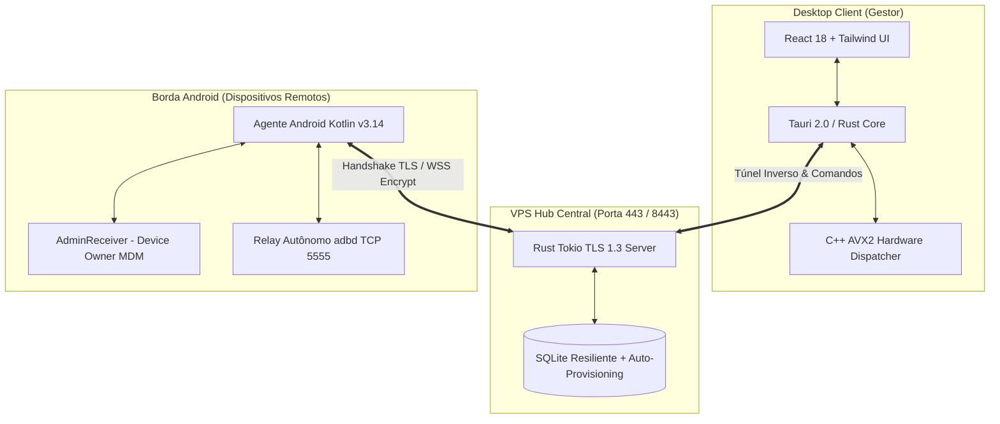

# ⚡ ESFERA v3 — Enterprise Android Fleet & Automation Platform

> **Plataforma High-Performance Computing (HPC) para Orquestração, Gestão MDM Enterprise e Controle Remoto Inteligente de Dispositivos Android.**

---


---

## 🚀 Visão Geral

O **Esfera v3** é uma solução de engenharia de alta performance desenvolvida para orquestração de frotas Android, espelhamento ultrarrápido, execução distribuída de comandos e gerenciamento remoto avançado em larga escala. 

Construído sob uma **arquitetura híbrida dual**, o sistema combina a flexibilidade de um agente standalone com o rigor de políticas **MDM Enterprise (Device Owner / DPC)**, operando sem gargalos através de um motor de roteamento vetorial acelerado por hardware **C++ SIMD (AVX2)**.

---

## 🏛️ Arquitetura do Sistema



---

## 🔥 Principais Tecnologias & Diferenciais

### 1. ⚡ HPC Engine: Motor Vetorial C++ SIMD (AVX2)
- **Runtime CPU Dispatching**: Detecção dinâmica de instruções vetoriais via `__cpuid` no boot (0ms overhead), selecionando automaticamente ponteiros de função otimizados para `AVX2`/`AVX-512` ou fallback genérico.
- **Zero-Copy FFI**: Comunicação de alta velocidade entre Rust e C++ sem cópia desnecessária de buffers em memória.

### 2. 🛡️ Arquitetura Dual Híbrida MDM Enterprise
- **Device Owner / DPC**: Suporte a permissões administrativas avançadas via `AdminReceiver.kt` e `device_admin.xml` com modo *Kiosk* e proteção *Lock Task*.
- **Command Allowlist**: Filtro de segurança no agente Android que valida comandos remotos através de um mapa imutável autenticado antes de qualquer execução shell.

### 3. 🌐 Transporte Resiliente & Túnel Inverso (TLS 1.3)
- **Bypass de NAT & Firewall (Portas 443 / 8443)**: Comunicação encriptada bidirecional entre o Hub VPS e os agentes remotos em redes corporativas ou 4G/5G.
- **Resiliência 403 (Auto-Provisionamento)**: Módulo `db.rs` em Rust com auto-inserção atômica de empresas (`INSERT INTO ESF_Company ... ON CONFLICT DO NOTHING`), eliminando falhas de credenciais no check-in.

### 4. 🎨 UI Linear SaaS (Desktop React 18)
- Interface ultramoderna desenvolvida em **React 18**, **TypeScript** e **Lucide Icons** com temática Dark Mode, filtros dinâmicos por setor, monitoramento de bateria/sinal e espelhamento em tempo real.

---

## 🛠️ Estrutura do Monorepo

```text
Esfera v3/
├── src/                        # Frontend React 18 + TypeScript (UI Desktop)
│   ├── components/             # Sub-componentes (Modais, Cards de Dispositivo)
│   └── pages/                  # Páginas principais (DevicesTab, Dashboards)
│
├── src-tauri/                  # Core Desktop em Rust & C++
│   ├── src/
│   │   ├── hpc_device_router.cpp # Motor C++ SIMD AVX2
│   │   ├── commands.rs         # Comandos Tauri & Bifurcação VPS
│   │   ├── tunnel_server.rs    # Servidor de Túnel Inverso
│   │   └── adb_manager.rs      # Gestor ADB Nativo
│   └── Cargo.toml
│
├── src-agent/                  # Agente Android Nativo (APK Kotlin)
│   ├── app/src/main/kotlin/    # Coroutines, WebSocket e Relay ADB
│   ├── AdminReceiver.kt        # Módulo MDM Enterprise DPC
│   └── runbuild.bat            # Script de compilação automatizado
│
└── hub-standalone/             # Servidor Hub VPS Central em Rust
    ├── src/
    │   ├── main.rs             # Bootstrap TLS 443 / 8443
    │   ├── db.rs               # SQLite com Auto-Provisionamento de CompanyId
    │   └── tls_server.rs       # Listener TLS 1.3 Assíncrono
    └── Cargo.toml
```

---

## ⚠️ Regras Críticas de Build (AGENTS.md / REGRA.md)

> [!CAUTION]
> **ATENÇÃO EXTREMA AO GERAR O EXECUTÁVEL DESKTOP**:
> 
> 1. **JAMAIS** utilize `cargo build` ou `cargo build --release` na pasta `src-tauri` para gerar o instalador do aplicativo. O `cargo build` apenas compila o backend Rust e **não empacota o frontend React**, resultando no erro `ERR_CONNECTION_REFUSED` no cliente.
> 
> 2. **O ÚNICO comando permitido para compilar o executável de produção standalone (.exe / .msi) é**:
>    ```bash
>    npm run tauri build
>    ```

---

## 💻 Como Compilar e Executar

### 1. Requisitos de Ambiente
- **Rust**: `1.80+` (MSVC no Windows)
- **Node.js**: `v18+` / `npm`
- **Android SDK**: NDK + Build Tools 34+
- **Compilador C++**: MSVC / Clang com suporte a AVX2 (`-mavx2` / `/arch:AVX2`)

### 2. Desenvolvimento Local (App Desktop)
```bash
# Instalar dependências
npm install

# Rodar em modo de desenvolvimento com Hot Reload
npm run tauri dev
```

### 3. Compilação do Agente Android
```bash
cd src-agent
runbuild.bat
# O APK assinado será gerado em: app/build/outputs/apk/release/app-release-signed.apk
```

### 4. Compilação do Servidor Hub VPS
```bash
cd hub-standalone
cargo build --release
```

---

## 📜 Licença

Propriedade exclusiva do ecossistema **Esfera**. Todos os direitos reservados. Uso restrito a ambientes autorizados.
