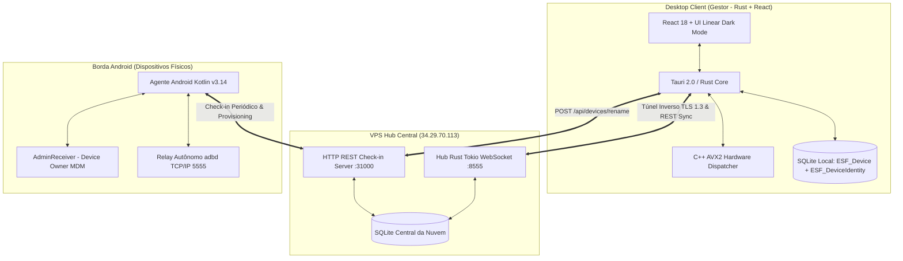
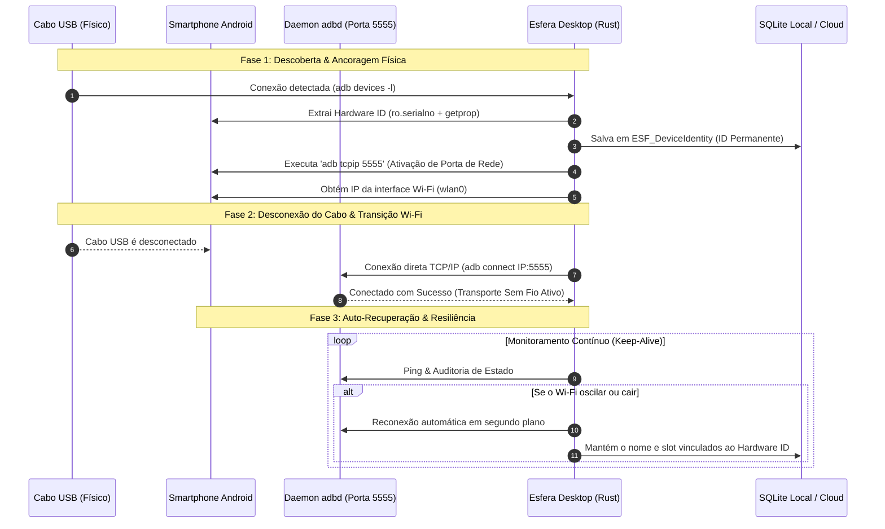
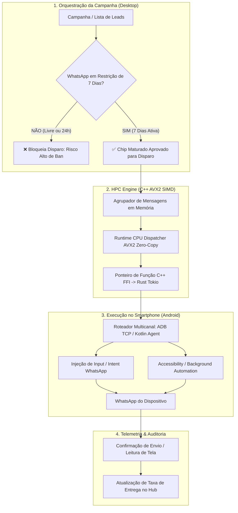
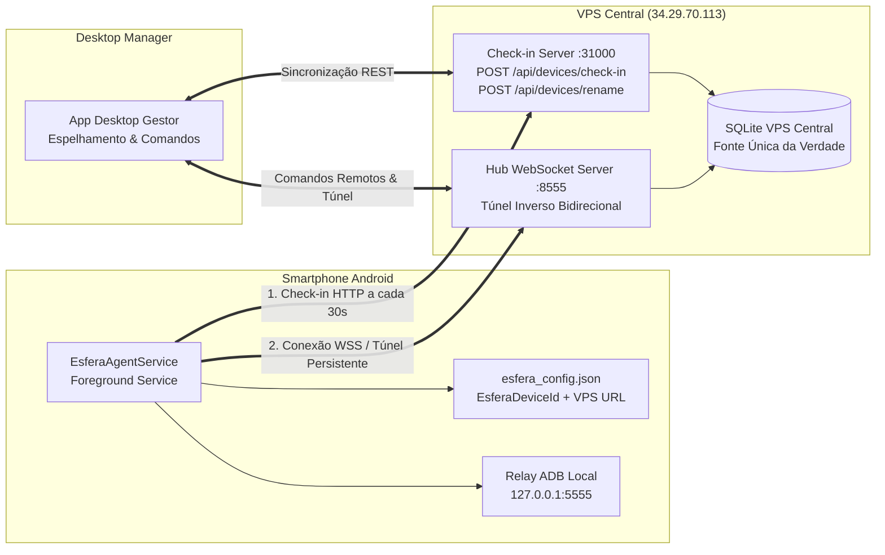

# ⚡ ESFERA v3 — Enterprise Android Fleet & Automation Platform

> **Plataforma High-Performance Computing (HPC) para Orquestração, Gestão MDM Enterprise e Controle Remoto Inteligente de Dispositivos Android.**

---


---

## 🚀 Visão Geral

O **Esfera v3** é uma solução corporativa de alta performance desenvolvida para orquestração de frotas Android, espelhamento ultrarrápido, execução distribuída de comandos e gerenciamento remoto avançado em escala industrial.

O ecossistema opera sob uma **arquitetura híbrida dual**: combina o rigor das políticas **MDM Enterprise (Device Owner / DPC)** com a agilidade do **Agente Kotlin Standalone**, impulsionado por um motor de roteamento vetorial acelerado por hardware **C++ SIMD (AVX2)** e sincronização atômica em nuvem com a **VPS Central**.

---

## 🏛️ Arquiteturas do Sistema & Fluxos Operacionais

### 1. 🌐 Arquitetura Global do Sistema (Visão Macro)



---

### 2. 🔌 Arquitetura de Conexão do Celular (Ciclo de Pareamento & Transporte)



---

### 3. ⚡ Arquitetura do Motor de Disparos em Massa (HPC SIMD + WhatsApp Restrição 7 Dias)



---

### 4. 📡 Arquitetura de Comunicação VPS ↔ Smartphone (Túnel Inverso, Agente Kotlin & Check-in)



---

## 🔥 Principais Módulos & Recursos

### 1. 📱 Identidade Permanente de Hardware & Imutabilidade Absoluta (`EsferaDeviceId`)
- **Ancoragem Indestrutível**: O dispositivo possui uma chave de hardware imutável baseada em número de série de fábrica e identificador de placa, gravada nas tabelas `ESF_DeviceIdentity` e `ESF_Device`.
- **Imutabilidade Absoluta de Nomes**: O nome atribuído pelo operador é **sacrossanto e perpétuo**. Nenhuma IA, script ou rotina de auto-discovery tem permissão de renomear ou reatribuir identificadores em massa.
- **Hierarquia Visual nos Cards**:
  - **Título Principal**: Nome personalizado pelo operador (*ex: Aparelho 1, WhatsApp Vendas, Motorola Loja SP*).
  - **Subtítulo**: Fabricante & Modelo de Hardware (*ex: Samsung SM-A155M*).
  - **Identificadores**: ID de Hardware (`EsferaDeviceId`) e endereço de rede ADB.

### 2. ☁️ Sincronização com VPS (Fonte Única da Verdade)
- **Sincronização Dupla**: Ao renomear ou reconfigurar qualquer celular, o desktop propaga a alteração instantaneamente via:
  1. `POST http://34.29.70.113:31000/api/devices/rename` (REST API).
  2. `HubClient::send_command("rename_device")` (WebSocket em tempo real).
- **Consistência Multi-Instância**: Mudanças efetuadas em qualquer computador da rede são sincronizadas imediatamente com a base da nuvem.

### 3. ⚙️ Painel de Configurações Enriquecido (5 Abas Modulares)
O botão de **3 pontinhos (`⋮`)** no card abre diretamente a central de configurações:
- **📱 Identidade & Operação**: Hardware ID com cópia em 1 clique, nome, slot, setor operacional (*Junior, Senior, PA Fixa, Pesquisa*) e grid técnico completo.
- **🖥️ Display & Interface Android**: Modo Escuro nativo, Manter Tela Ligada no Carregador (*Stay Awake*), Exibir Toques (*Ponto Branco para Auditoria*), Escala de Animações (*0x, 0.5x, 1.0x*) e Densidade DPI com Reset.
- **📡 Rede, Wi-Fi & VPS**: Política de Suspensão Wi-Fi (*Sleep Policy 2 - Nunca suspender*), Reativação Forçada da Porta ADB 5555 TCP/IP e Teste de Ping com a VPS.
- **⚡ Performance HPC**: Limpeza profunda de Memória RAM & Cache e Debloat de Bloatwares de Fábrica (*Bixby, Facebook, operadoras*).
- **🛡️ Provisionamento & Ações do Sistema**:
  - **Provisionar Agente**: Grava `/sdcard/esfera_config.json` e inicia o `EsferaAgentService`.
  - **Atualizar APK**: Reinstalação remota forçada do `Esfera_Agent_ADB.apk`.
  - **Reboot Remoto**: Reinicialização do hardware Android.
  - **🚨 Zona de Perigo**: Desconexão e remoção segura com diálogo de confirmação.

### 4. ⚡ Motor HPC C++ SIMD (AVX2 Runtime Dispatching)
- **Runtime CPU Dispatching**: Detecção dinâmica de instruções via `__cpuid` no boot (0ms overhead), selecionando automaticamente ponteiros de função `AVX2`/`AVX-512` ou genéricos.
- **Zero-Copy FFI**: Processamento de buffers de entrada de logs e frames de vídeo via FFI sem overhead de alocação de memória.

### 5. 🎨 Design UIX & Correção Global de Inputs
- Interface moderna estilo Linear SaaS em Dark Mode.
- Resolução da especificidade de CSS com classes utilitárias isoladas (`.input-with-icon-left`, `.input-icon-left`), impedindo a sobreposição de ícones sobre campos de texto em todas as páginas do sistema.

---

## 🛠️ Estrutura do Monorepo

```text
Esfera v3/
├── src/                        # Frontend React 18 + TypeScript (UI Desktop)
│   ├── components/             # Sub-componentes (DeviceCard, DeviceConfigModal, Toolbar)
│   ├── pages/                  # Páginas (DevicesTab, CampaignsTab, AutomationsTab, LogsTab)
│   └── index.css               # Design System com utilitários de input e layout
│
├── src-tauri/                  # Core Desktop em Rust & C++
│   ├── src/
│   │   ├── hpc_device_router.cpp # Motor C++ SIMD AVX2 com Runtime Dispatching
│   │   ├── commands.rs         # Comandos Tauri, Sincronização VPS & ADB
│   │   ├── db.rs               # SQLite com Identidade Permanente e Transações Atômicas
│   │   ├── tunnel_server.rs    # Túnel Inverso TLS 1.3
│   │   └── adb_manager.rs      # Gestor ADB de Alta Concorrência
│   └── Cargo.toml
│
├── src-agent/                  # Agente Android Nativo (APK Kotlin)
│   ├── app/src/main/kotlin/    # Coroutines, WebSocket Client e Relay ADB
│   ├── AdminReceiver.kt        # Módulo MDM Enterprise DPC
│   └── runbuild.bat            # Script de compilação automatizado
│
└── hub-standalone/             # Servidor Hub VPS Central em Rust
    ├── src/
    │   ├── main.rs             # Bootstrap e Listeners das portas
    │   ├── checkin_server.rs   # API REST Check-in e Endpoint /api/devices/rename
    │   ├── db.rs               # SQLite Central na VPS
    │   └── tls_server.rs       # Listener TLS 1.3
    └── Cargo.toml
```

---

## 🚨 Regra Crítica Operacional de Disparo (WhatsApp / Restrição Ativa de 7 Dias)

> [!WARNING]
> ### ⏳ PROTOCOLO OBRIGATÓRIO: DISPARO EXCLUSIVO EM WHATSAPP COM RESTRIÇÃO ATIVA DE 7 DIAS
> 
> **Qualquer disparo em massa ou campanha ativa SÓ PODE SER EXECUTADO se a conta do WhatsApp estiver ATUALMENTE EM RESTRIÇÃO ATIVA DE 7 DIAS.**
> 
> - 🛡️ **Por que disparar durante a restrição de 7 dias?**: Quando a conta do WhatsApp já se encontra sob o estado de restrição ativa de 7 dias, o sistema de detecção comportamental da Meta dificilmente aplica banimento imediato adicional, conferindo alta resistência, tolerância e resiliência ao chip durante o fluxo massivo de envios.
> - ❌ **Contas Livres (Sem Restrição)**: **PROIBIDO DISPARAR**. Contas livres possuem risco crítico e imediato de sofrerem restrição severa ou **banimento permanente definitivo** logo nos primeiros disparos.
> - ⚠️ **Restrição de 24 Horas**: **NÃO SE APLICA a este requisito**. A restrição temporária de 24 horas não oferece a proteção de tolerância necessária; apenas o estado de **restrição ativa de 7 dias** qualifica o WhatsApp para execução de disparos.

---

## ⚠️ Regras Críticas de Build (AGENTS.md / REGRA.md)

> [!CAUTION]
> **ATENÇÃO EXTREMA AO GERAR O EXECUTÁVEL DESKTOP**:
> 
> 1. **JAMAIS** utilize `cargo build` ou `cargo build --release` na pasta `src-tauri` para gerar o instalador do aplicativo. O `cargo build` compila apenas o backend Rust e **não empacota o frontend React**, resultando no erro `ERR_CONNECTION_REFUSED` no cliente.
> 
> 2. **O ÚNICO comando permitido para compilar o executável de produção standalone (.exe / .msi) é**:
>    ```bash
>    npm run tauri build
>    ```

---

## 💻 Como Compilar e Executar

### 1. Requisitos de Ambiente
- **Rust**: `1.80+` (MSVC no Windows)
- **Node.js**: `v18+` / `npm`
- **Android SDK**: NDK + Build Tools 34+
- **Compilador C++**: MSVC / Clang com suporte a AVX2 (`/arch:AVX2` ou `-mavx2`)

### 2. Desenvolvimento Local (App Desktop)
```bash
# Instalar dependências do frontend
npm install

# Rodar com Hot-Reload (Frontend + Backend Rust)
npm run tauri dev
```

### 3. Gerar Executável de Produção Standalone (.exe)
```bash
npm run tauri build
# O binário final é gerado em: src-tauri/target/release/esfera_v3.exe
```

### 4. Compilação do Agente Android
```bash
cd src-agent
runbuild.bat
# APK gerado em: app/build/outputs/apk/release/app-release-signed.apk
```

### 5. Compilação do Servidor Hub VPS
```bash
cd hub-standalone
cargo build --release
```

---

## 📜 Licença

Propriedade exclusiva do ecossistema **Esfera**. Todos os direitos reservados. Uso restrito a ambientes autorizados.
