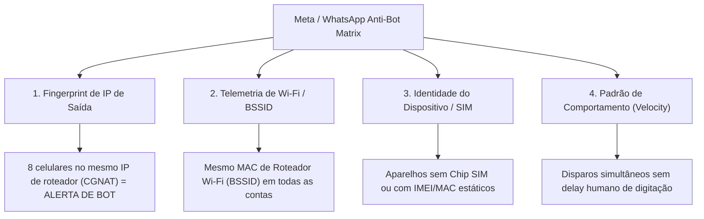

# 📋 STATUS EM FALTA: Pedidos & Plano de Implementação para Amanhã

> [!IMPORTANT]
> **Documento Estratégico de Desenvolvimento - Esfera Hub v3**
> Data de Início: **Amanhã**
> Escopo: Controle Remoto Open-Source, Disparo por Toque Físico Real e Arquitetura Anti-Banimento de Rede.

---

# 🚀 PARTE 1: Resumo dos Pedidos em Aberto ("Status em Falta")

| Item | Descrição do Pedido | Status Atual | Prioridade |
| :--- | :--- | :--- | :--- |
| **1. Controle Remoto Open-Source** | Espelhamento multitela em grade (4x2) via `scrcpy-server` C++/Rust com telas físicas dos celulares desligadas (`--turn-screen-off`). | 📝 Desenhado (Obsidian) | 🔴 Alta |
| **2. Disparo por Toque Real** | Substituição do `keyevent 66` por Intent + Clique Físico em Coordenadas Normalizadas (`input tap`) e Agente Accessibility (`com.whatsapp:id/send`). | 📝 Desenhado (Obsidian) | 🔴 Alta |
| **3. Mascaramento de Rede & Anti-Ban** | Isolamento de IP/Rede por celular, bloqueio de telemetria de roteador (BSSID) e motor de comportamento humano. | 💡 Especificado Neste Doc | 🚀 Máxima |

---

# 🛡️ PARTE 2: Plano de Implementação - Mascaramento de Rede & Prevenção Anti-Banimento

## 🔍 1. Diagnóstico: Como o WhatsApp/Meta Detecta e Bane Celulares na Mesma Rede?

Quando múltiplos celulares (ex: 8 aparelhos) operam no mesmo local, o algoritmo do WhatsApp cruza 4 vetores de telemetria para identificar e banir a operação:



---

## 🛠️ 2. Soluções e Plano de Ação Técnico por Camada

### 🟢 Camada 1: Mascaramento de IP de Saída (Isolamento por Celular)
* **Causa do Ban**: Todos os 8 celulares compartilham o mesmo IP público do roteador Wi-Fi local. Se uma conta é banida, o IP entra em "Warmup Flag" e derruba as outras 7.
* **Solução**: **Proxy SOCKS5 Residencial de 4G/5G Dedicado por Celular**.
  * Cada celular navegará por um IP público totalmente isolado e dinâmico.
  * **Implementação**: Configurar clientes VPN/WireGuard ou conexões SOCKS5 individuais no perfil de cada aparelho usando comandos ADB de configuração de VPN global (`adb shell settings put global http_proxy`).

---

### 🟢 Camada 2: Bloqueio de Leitura de BSSID / Roteador Wi-Fi
* **Causa do Ban**: O app do WhatsApp solicita permissão de localização para ler o **BSSID (Endereço MAC físico do seu Roteador Wi-Fi)**. Mesmo mudando de IP via VPN, se o BSSID for o mesmo em 8 celulares, o Meta sabe que estão no mesmo cômodo.
* **Solução**: Bloquear a leitura de localização e antenas Wi-Fi no Android via ADB.
  * **Comando de Proteção ADB**:
    ```bash
    # Revoga permissões de localização que permitem ler o BSSID do roteador Wi-Fi
    adb -s <SERIAL> shell pm revoke com.whatsapp android.permission.ACCESS_FINE_LOCATION
    adb -s <SERIAL> shell pm revoke com.whatsapp android.permission.ACCESS_COARSE_LOCATION
    adb -s <SERIAL> shell pm revoke com.whatsapp.w4b android.permission.ACCESS_FINE_LOCATION
    ```

---

### 🟢 Camada 3: Validação de Identidade Celular (SIM Card & Carrier Telephony)
* **Causa do Ban**: Contas operando em aparelhos sem chip SIM físico (`TelephonyManager.getSimState() == ABSENT`) recebem pontuação de risco elevada (Trust Score baixo).
* **Solução**: 
  * Manter chips SIM ativos (mesmo pré-pago sem recarga) em cada um dos 8 aparelhos.
  * Alternar entre dados móveis 4G/5G e Wi-Fi de forma distribuída.

---

### 🟢 Camada 4: Motor de Humanização de Disparos em C++ (HPC Delay Engine)
* **Causa do Ban**: Disparar mensagens exatamente no mesmo intervalo de tempo (ex: a cada 5.0 segundos) ou sem tempo de digitação proporcional ao tamanho do texto.
* **Solução**: **Humanized Timing Generator em C++**:

```cpp
// hpc_human_delay.hpp - Gerador de Intervalo Humano Baseado em Distribuição Gaussiana
#pragma once
#include <random>
#include <chrono>
#include <thread>

namespace EsferaHPC {
    inline void wait_humanized_typing(size_t message_length) {
        // Simula tempo de digitação humana: ~35 ms por caractere + jitter aleatório
        double base_ms = message_length * 35.0;
        
        std::random_device rd;
        std::mt19937 gen(rd());
        std::normal_distribution<> d(base_ms, 800.0); // Desvio padrão de 800ms

        int final_delay_ms = std::max(1200, static_cast<int>(d(gen)));
        std::this_thread::sleep_for(std::chrono::milliseconds(final_delay_ms));
    }
}
```

---

# 📅 PARTE 3: Cronograma de Execução para Amanhã

1. [ ] **09:00 - 11:00**: Implementação da inicialização do `scrcpy-server` no backend Rust com suporte a `--turn-screen-off`.
2. [ ] **11:00 - 13:00**: Atualização da engine de disparo para o fluxo **Intent Deep Link + Clique Físico em Coordenadas Normalizadas (`input tap`)**.
3. [ ] **14:00 - 16:00**: Aplicação das regras de isolamento de rede (VPN / Proxy por celular + revogação de permissões de localização BSSID via ADB).
4. [ ] **16:00 - 18:00**: Teste integrado de envio em lote nos 8 celulares e validação de estabilidade.

---
*Documento salvo na raiz do projeto Esfera v3 para acompanhamento de tarefas de amanhã.*
