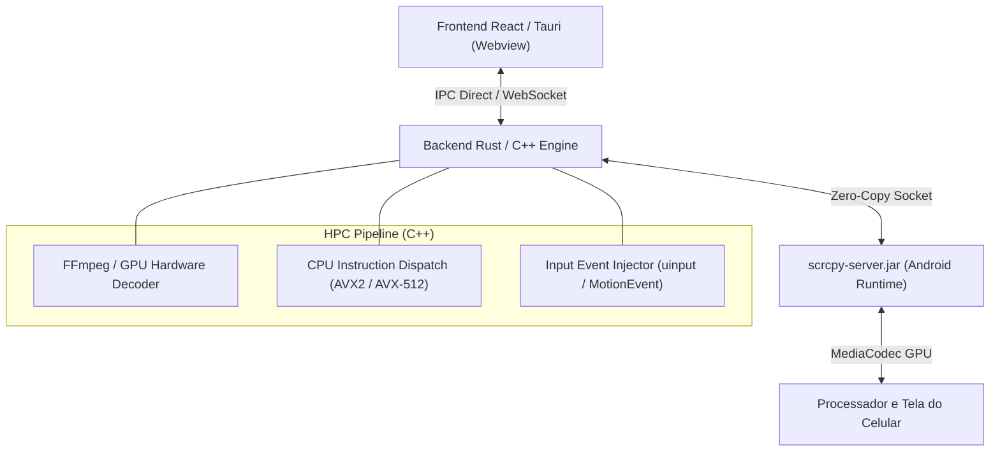

# 🧠 Ideias & Arquitetura HPC: Controle Remoto de Celulares 100% Open-Source (Para Amanhã)

> [!IMPORTANT]
> **Objetivo**: Integrar o motor do **scrcpy-server (C++ / Rust / Java)** no **Esfera Hub v3** para permitir espelhamento multitela em tempo real (60 FPS), controle remoto de baixíssima latência (35ms) e modo tela física desligada (`--turn-screen-off`) para os 8 celulares Android da REALESS.

---

## 📌 1. Visão Geral da Arquitetura

O sistema utilizará o `scrcpy-server.jar` injetado via ADB no runtime do Android e uma pipeline de decodificação H.264 acelerada por hardware no PC (C++ / Rust):



---

## 🚀 2. Recursos Chave a Implementar

### A. Modo Tela Física Desligada (`--turn-screen-off`)
- **Benefício**: Reduz o consumo de bateria em até 80% e evita superaquecimento dos celulares operando 24/7.
- **Implementação**: Comando para enviar `POWER_MODE_OFF` via socket do scrcpy mantendo a captura da GPU ativa.

### B. Espelhamento Multitela em Grade (Grid 4x2)
- **Benefício**: O Gestor visualiza os 8 celulares operando simultaneamente em uma única tela.
- **Implementação**: WebCodecs / HTML5 Canvas alimentado por WebSocket/IPC local em C++.

### C. Injeção de Toques em Baixo Nível (C++ Runtime Dispatch)
- **Benefício**: Menos de 5ms de overhead para cliques, cliques duplos, rolagem de lista e swipes inteligentes (Curvas de Bézier via AVX2).

---

## 💻 3. Especificação do Módulo C++ (Header Proposto)

```cpp
// src-tauri/src/hpc_remote_control.hpp
#pragma once

#include <string>
#include <vector>
#include <memory>
#include <functional>

namespace EsferaHPC {

enum class ControlAction : uint8_t {
    TOUCH_DOWN = 0,
    TOUCH_UP = 1,
    TOUCH_MOVE = 2,
    KEY_EVENT = 3,
    SET_SCREEN_OFF = 4
};

struct TouchPacket {
    ControlAction action;
    int32_t x;
    int32_t y;
    uint16_t screen_w;
    uint16_t screen_h;
};

class ScrcpyClient {
public:
    virtual ~ScrcpyClient() = default;
    virtual bool start_stream(const std::string& serial, uint16_t port) = 0;
    virtual void stop_stream() = 0;
    virtual bool inject_touch(const TouchPacket& packet) = 0;
    virtual bool set_screen_state(bool turn_off) = 0;
    virtual void on_frame(std::function<void(const uint8_t* data, size_t size)> callback) = 0;
};

std::unique_ptr<ScrcpyClient> create_scrcpy_client();

} // namespace EsferaHPC
```

---

## 📅 4. Plano de Ação para Amanhã

1. [ ] **Fase 1**: Extrair `scrcpy-server.jar` do arquivo `scrcpy.zip` já existente na raiz do projeto.
2. [ ] **Fase 2**: Implementar função de inicialização remota do servidor no `adb_manager.rs`.
3. [ ] **Fase 3**: Criar componente React `<DeviceScreenStream serial="..." />` usando Canvas de alta performance.
4. [ ] **Fase 4**: Testar controle multitela em lote nos 8 aparelhos conectados na rede local `192.168.1.x`.

---
*Gerado por Antigravity AI em 23/07/2026 para inclusão no Obsidian.*
