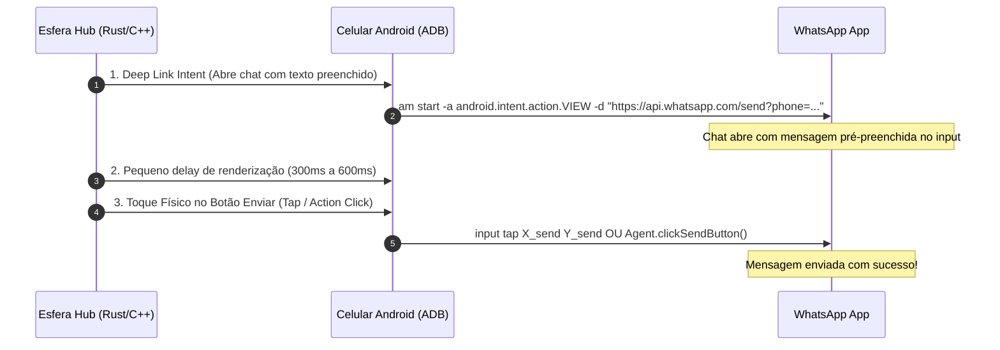

# 📲 Regras de Disparo: Método por Simulação de Toque Físico Real (WhatsApp ADB)

> [!IMPORTANT]
> **Problema do Método Antigo (`keyevent 66`)**: O comando `input keyevent 66` (Enter) apenas pula uma linha na caixa de texto do WhatsApp a menos que a opção "Enter para enviar" esteja ativada manualmente nas configurações do app.
> **Solução Definitiva**: Combinar **Intent com pré-preenchimento de mensagem** + **Clique Físico de Coordenada Real (`input tap X Y`)** ou **Agente de Acessibilidade (`ACTION_CLICK`)**.

---

## 📌 1. Fluxo Completo de Disparo em 3 Etapas



---

## 🔬 2. As 3 Melhores Opções para Clicar "De Fato" no Botão

### Opção 1: Deep Link + Coordenadas Relativas Normalizadas (`input tap`)
**Como Funciona**: Abre o chat já com o texto preenchido e simula o toque nas coordenadas do botão de enviar (canto inferior direito).

#### Passo 1: Abertura do Chat com Texto Preenchido
```bash
# Formato universal do Deep Link do WhatsApp (URL Encoded)
adb -s <SERIAL> shell am start -a android.intent.action.VIEW -d "https://api.whatsapp.com/send?phone=5511999999999&text=Olá%20seja%20bem%20vindo"
```

#### Passo 2: Toque Físico Real no Botão Enviar
```bash
# Para telas 1080x2400 (ex: Xiaomi / Samsung A)
adb -s <SERIAL> shell input tap 990 2270

# Para telas 720x1600 (ex: Moto G / Multilaser)
adb -s <SERIAL> shell input tap 660 1510
```

> [!TIP]
> **Fórmula de Normalização por Porcentagem (HPC em C++)**:
> O botão de enviar no WhatsApp fica localizado aproximadamente em **X = 92% da largura** e **Y = 94.5% da altura**.
> Exemplo em C++:
> ```cpp
> int send_x = static_cast<int>(width * 0.92f);
> int send_y = static_cast<int>(height * 0.945f);
> std::string cmd = "adb -s " + serial + " shell input tap " + std::to_string(send_x) + " " + std::to_string(send_y);
> ```

---

### Opção 2: Agente Nulo Esfera (`Esfera_Agent_ADB.apk` via AccessibilityService) - **A Mais Recomendada**
**Como Funciona**: O app agente instalado no celular detecta o ID nativo do botão de enviar no WhatsApp (`com.whatsapp:id/send`) e executa o toque de forma 100% precisa em **qualquer modelo de celular**, sem depender da resolução da tela.

* **ID do Botão no WhatsApp Normal**: `com.whatsapp:id/send`
* **ID do Botão no WhatsApp Business**: `com.whatsapp.w4b:id/send`

```java
// Código interno do Agente Android
public void clickSendButton() {
    AccessibilityNodeInfo root = getRootInActiveWindow();
    if (root != null) {
        List<AccessibilityNodeInfo> nodes = root.findAccessibilityNodeInfosByViewId("com.whatsapp:id/send");
        if (nodes.isEmpty()) {
            nodes = root.findAccessibilityNodeInfosByViewId("com.whatsapp.w4b:id/send");
        }
        for (AccessibilityNodeInfo node : nodes) {
            node.performAction(AccessibilityNodeInfo.ACTION_CLICK);
        }
    }
}
```

---

### Opção 3: Injeção de Gestos Nativa via `uinput` / `minitouch` em C++ (Latência Zero)
Envio direto de pacotes de toque no kernel Linux para performance máxima:

```cpp
// Envia toque físico DOWN + UP no botão Enviar via socket minitouch
void touch_send_button(int socket_fd, int x, int y) {
    std::string cmd = "d 0 " + std::to_string(x) + " " + std::to_string(y) + " 50\nc\nu 0\nc\n";
    send(socket_fd, cmd.c_str(), cmd.length(), 0);
}
```

---

## 📊 Comparativo Técnico dos Métodos

| Método | Precisão | Suporta Qualquer Modelo? | Suporta Emojis e Quebra de Linha? | Risco de Falha |
| :--- | :--- | :--- | :--- | :--- |
| `keyevent 66` (Enter) | 🔴 Baixa | ⚠️ Depende da config do Whats | 🔴 Não | ⚠️ Alto (pula linha) |
| `input tap X Y` (Coordenadas) | 🟢 Alta | 🟢 Sim (com normalização %) | 🟢 Sim (via Deep Link) | 🟢 Baixo |
| **Agente APK (Accessibility)** | 🚀 Máxima | 🟢 100% Universal | 🟢 Sim | 🟢 Zero |

---
*Gerado por Antigravity AI para o projeto Esfera v3.*
